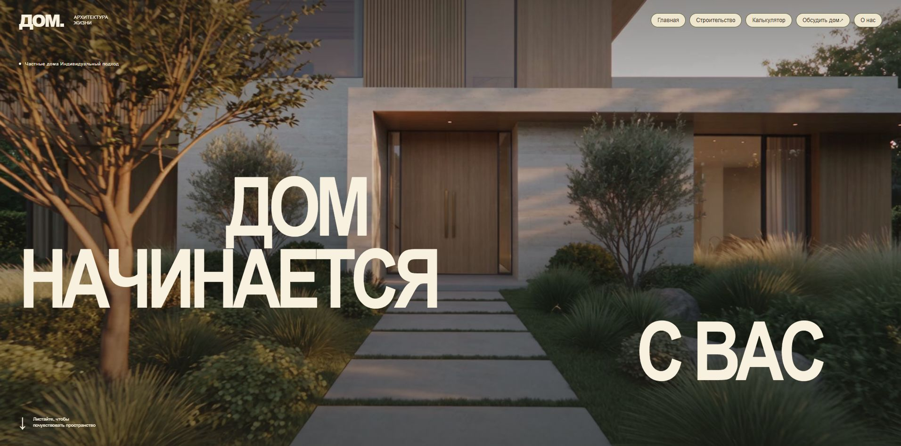

# Сайт о строительстве домов

[Открыть демоверсию](https://193.187.96.95:4180/) · [Скриншоты всех страниц](docs/screenshots.md)

Посетитель может сравнить проекты домов и бань, прикинуть стоимость строительства и скачать расчёт в PDF. На главной видео реагирует на прокрутку. Через закрытую панель редактор меняет тексты, фотографии, карточки и расценки.



## Как посмотреть и проверить

1. Откройте демоверсию и прокрутите главную.
2. В «Строительстве» откройте карточку дома и посмотрите площадь, материал и ориентировочную цену.
3. В «Калькуляторе» измените площадь или материал, проверьте, что сумма обновилась, и нажмите «Скачать расчёт PDF».

Цены и контакты приведены для демонстрации. Формы не отправляют обращения.

## Как устроен проект

- HTML, CSS и JavaScript. В `src/pages` лежат страницы, в `src/components` — общие элементы, в `src/data` — карточки и настройки расчёта. Сборка создаёт готовые страницы в `dist/`.
- **Lenis** отвечает за плавную прокрутку. **PDF-LIB** и **Fontkit** создают PDF с кириллицей в браузере. Библиотеки поставляются вместе с сайтом.
- **Node.js** и **SQLite** обслуживают панель и хранят её данные. Для загрузки страниц используются готовый HTML и модули по разделам. Фото сжаты в WebP, для видео предусмотрены версии под разные экраны.

## Запуск на компьютере

Если у вас есть копия исходников, установите Node.js 24 или новее и откройте терминал в папке проекта. Установка npm-пакетов не требуется.

```sh
npm run dev
```

Откройте [http://127.0.0.1:4180/](http://127.0.0.1:4180/). На Windows сервер также запускается двойным щелчком по `START.cmd`. После изменений выполните `npm run build`. Команда `npm run check` проверяет синтаксис, `npm test` запускает автоматические тесты.
